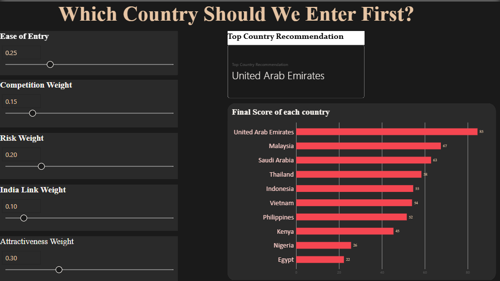

# market-entry-scorecard
Power BI + SQL scorecard recommending which country an Indian FMCG company should enter first
# Market Entry Scorecard: Which Country Should an Indian FMCG Company Enter First?

A data-driven market entry analysis built with **MySQL** and **Power BI**, recommending which of 10 countries an Indian personal care/beauty company should prioritize for international expansion.

## Problem

A mid-size Indian FMCG company wants to expand internationally but needs a structured, defensible answer to: **which country should we enter first?**

## Scope

10 countries across Southeast Asia and the Middle East/Africa: Vietnam, Indonesia, Thailand, Malaysia, Philippines, UAE, Saudi Arabia, Nigeria, Kenya, Egypt.

## Framework

| Group | Weight | Metrics |
|---|---|---|
| Market Attractiveness | 30% | Population (15-64), GDP per capita, Household consumption growth |
| Ease of Entry | 25% | Import tariff on cosmetics, Ease of doing business score |
| Competition | 15% | Cosmetics import value (proxy for market crowding) |
| Risk | 20% | Inflation, Political stability, Currency volatility |
| India Link | 10% | Bilateral trade with India, Trade agreement status, Indian diaspora population |

## Data Sources

- **World Bank (DataBank)** — GDP, population, inflation, consumption growth, political stability, ease of doing business, exchange rates
- **UN Comtrade** — Cosmetics import value, bilateral trade with India
- **WTO** — Average applied import tariffs
- **Ministry of Commerce / Ministry of External Affairs (India)** — Trade agreement status, diaspora population

Reference year: 2023, with documented exceptions.

## Methodology

1. **Normalization** — every metric scaled 0-100 using min-max scaling (cost metrics inverted)
2. **Weighting** — each group's weight split equally across its own metrics
3. **Final score** — weighted, normalized metrics summed into one composite score per country

## SQL

- [`01_schema.sql`](./01_schema.sql) — database schema (`countries`, `raw_metrics`)
- [`02_normalization_view.sql`](./02_normalization_view.sql) — min-max normalization using window functions
- [`03_weighted_scoring.sql`](./03_weighted_scoring.sql) — CTE-based weighted scoring query

## Power BI Dashboard

Interactive dashboard with **What-If Parameters**, allowing live adjustment of group weights to test different strategic priorities.

**Page 1 — Overview:** live weighted ranking with adjustable sliders

**Page 2 — Country Deep Dive:** radar chart breakdown by criteria group

**Page 3 — Recommendation:** summary and limitations

## Result (Baseline Weighting)

| Rank | Country | Score |
|---|---|---|
| 1 | UAE | 84.6 |
| 2 | Malaysia | 67.5 |
| 3 | Saudi Arabia | 62.9 |
| 4 | Thailand | 58.4 |
| 5 | Indonesia | 54.6 |
| 6 | Vietnam | 54.0 |
| 7 | Philippines | 51.6 |
| 8 | Kenya | 45.4 |
| 9 | Nigeria | 25.6 |
| 10 | Egypt | 22.3 |

**UAE ranks first**, driven by strong economic fundamentals, political stability, zero currency volatility (USD peg), and an existing trade agreement with India (CEPA).

## Limitations

- Public data only — a real engagement would validate with primary research
- Some proxies used where direct data was unavailable
- Nigeria's household consumption growth excluded (no data available)
  
